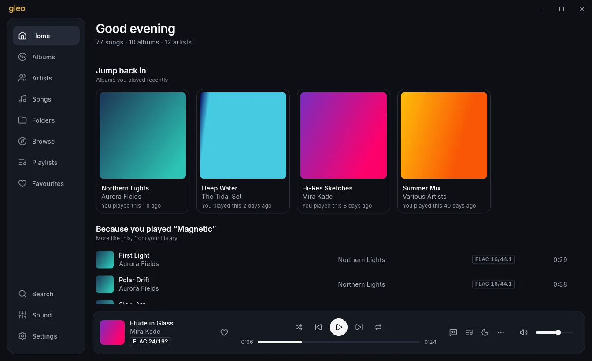
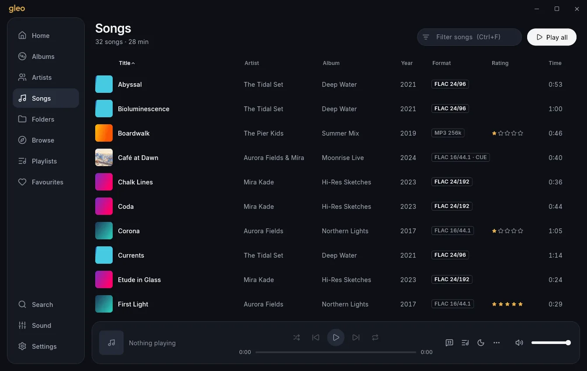
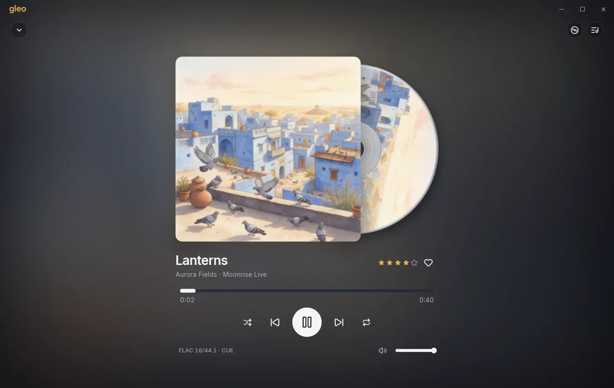
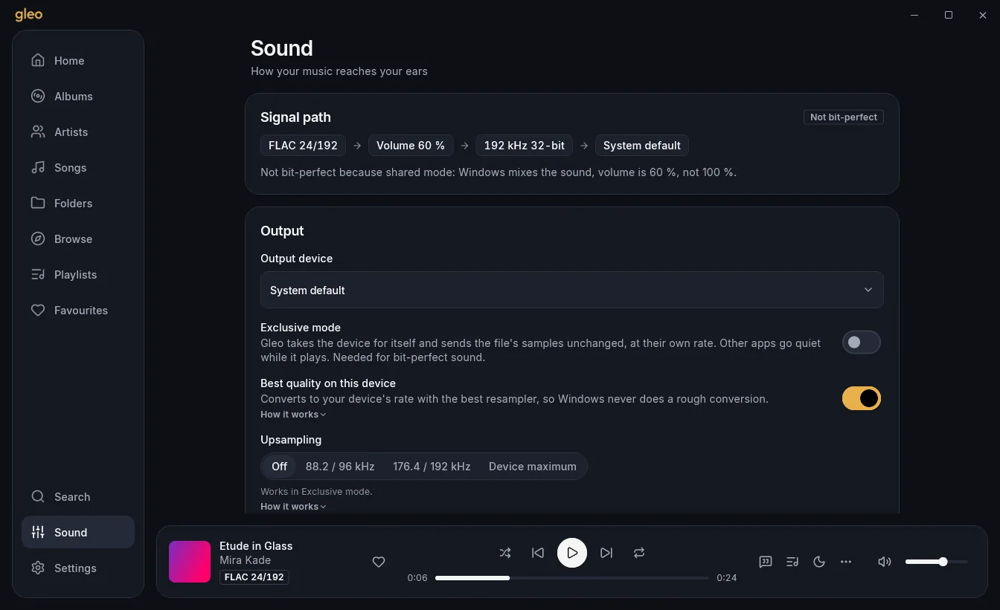
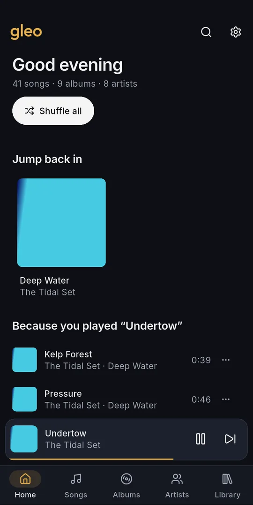
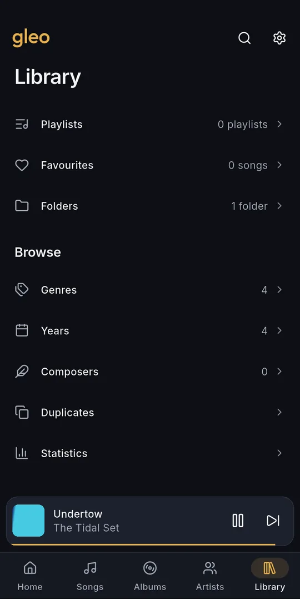
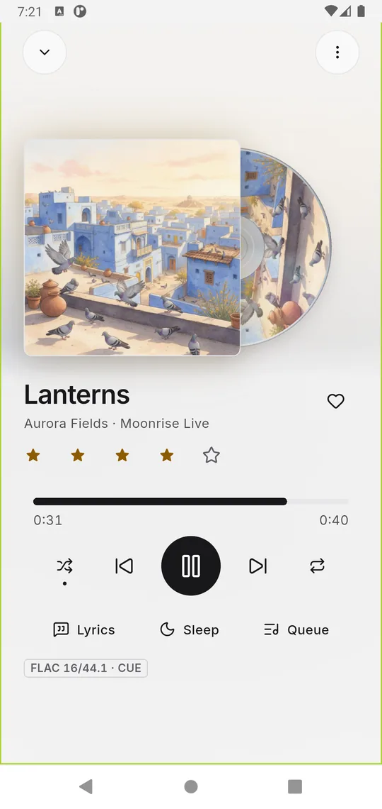
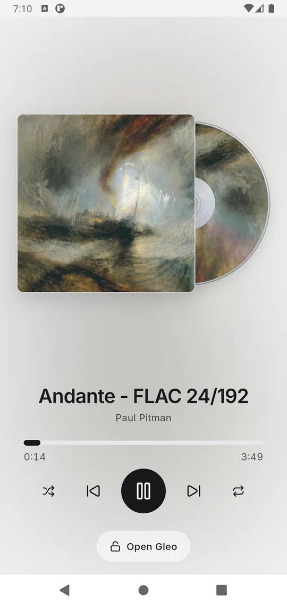

# Gleo

A free, fast music player for lossless libraries, on **Windows** and **Android**. Gapless playback, exact seeking in every format, a proper equalizer (with AutoEQ headphone correction), CUE sheets, smart playlists, star ratings and a spinning CD. **No AI, no accounts, no ads**: Gleo only reads your own music folders, and nothing goes to the internet unless you switch it on.

Gleo (said "GLAY-oh") is the Old English word *glēo*: music, joy. Until 0.4 it was called Lumen.

## Download

Get the latest version from **[Releases](https://github.com/capsuleutkarsh-design/gleo/releases/latest)**:

- **Windows 10 / 11 (64-bit):** `Gleo-Setup-<version>.exe`, or the portable `.zip`.
- **Android 8 or newer:** `Gleo-<version>-android-arm64-v8a.apk` (almost every phone). The `armeabi-v7a` file is for old 32-bit phones, `x86_64` for emulators.

Website and guide: https://capsuleutkarsh-design.github.io/gleo/

## Screenshots

**Windows: Home**

**Windows: Songs with ratings and a CUE album**

**Windows: Now Playing**

**Windows: Sound (equalizer, headphone correction, crossfeed, quality)**

**Android: Home, Library, Now Playing and the lock-screen disc view**

## Licence

Gleo is free to use, made by Utkarsh Tripathi. It is not for sale. Please do not re-upload the setup or remove the author's name. The full licence is shown in the app (Settings → About → Credits) and in the Windows installer.

Gleo's audio engine (mpv + FFmpeg, LGPL) is built in public at [gleo-audio-engine](https://github.com/capsuleutkarsh-design/gleo-audio-engine).

Questions and bug reports: [capsuleutkarsh@gmail.com](mailto:capsuleutkarsh@gmail.com)
